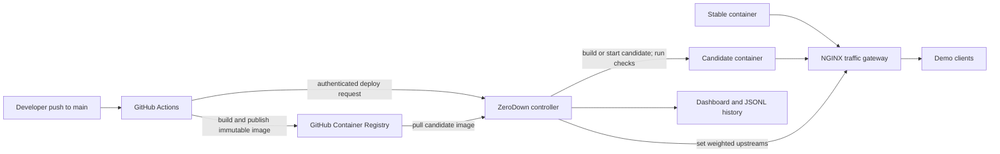

# ZeroDown

ZeroDown is a small, self-hosted progressive deployment demo for Docker-based
applications. It builds or pulls a candidate version, checks it, shifts traffic
through configured stages, and restores the stable route when a rollout fails.
It is designed to make those decisions visible during a student project or
hackathon demonstration. It is not a production orchestrator.

## 1. Project overview

The repository contains a FastAPI deployment controller, an NGINX traffic
gateway, a sample FastAPI application, and a second example application. Docker
Compose starts the demo controller, gateway, and sample versions. The controller
uses the Docker Engine API to build and run candidate containers.

## 2. Problem statement

Replacing a running application in one step can expose every user to a broken
release. A small team also needs a clear way to see whether a rollout is
progressing, what checks passed, and why a release was stopped.

## 3. Solution

ZeroDown keeps a stable version serving traffic while it validates a candidate.
It changes the NGINX traffic weights according to `zerodown.yaml`, observes
health and configured safety signals, and either promotes the candidate or
routes traffic back to the stable version. The dashboard shows the current
state, traffic split, metrics, events, and recent deployment records.

## 4. Architecture



In the local demo, Compose supplies the initial V1 service and NGINX gateway.
The controller manages the candidate container and writes the current traffic
configuration to the shared NGINX config. The GitHub Actions workflow is
optional; the dashboard can run the local demonstration without GitHub.

## 5. Features

- YAML configuration for application build context, Dockerfile, port, health
  endpoint, smoke endpoints, rollout stages, and safety limits.
- Candidate build/start and health, readiness, and smoke checks.
- Configurable weighted traffic stages; the sample uses 10%, 25%, 50%, and
  100% candidate traffic.
- Rollback on failed validation or exceeded rollout thresholds.
- Dashboard status, version health, traffic share, metrics, event log, and
  recent deployment history.
- JSON Lines deployment history under `data/`, preserved by the Compose bind
  mount across container restarts.
- Optional GitHub Actions flow that publishes a commit-tagged GHCR image and
  asks ZeroDown to deploy it.
- A deterministic failure demo that makes the candidate return HTTP 500 during
  the 50% canary stage.

Metrics are collected during rollout observations from requests through the
gateway and Docker container statistics. They are demonstration signals; they
are not a substitute for a production monitoring system.

## 6. Configuration example

The default configuration is [`config/zerodown.yaml`](config/zerodown.yaml):

```yaml
app:
  name: demo-app
  build_context: ./app
  dockerfile: dockerfile
  port: 8000

health:
  endpoint: /health
  canary_endpoint: /
  smoke_endpoints:
    - /ready
    - /api/data

rollout:
  stages: [10, 25, 50, 100]
  stage_seconds: 3
  observation_seconds: 15

limits:
  max_error_rate: 5
  max_latency_ms: 1000
  max_cpu_percent: 90
  max_memory_percent: 90
  max_risk_percent: 65
```

The controller validates the YAML during startup and reports the invalid field
when the configuration cannot be loaded. See
[`examples/notes-service/zerodown.yaml`](examples/notes-service/zerodown.yaml)
for a second application using a different port and health endpoint. The
optional `health.canary_endpoint` selects the path for synthetic requests sent
through the gateway during monitoring; it defaults to the first smoke endpoint
or the health endpoint.

## 7. Local setup

Python 3.12 is used by the application and tests. To install the local test and
controller dependencies on Windows PowerShell:

```powershell
py -3.12 -m venv .venv
.\.venv\Scripts\python.exe -m pip install -r controller\requirements.txt
.\.venv\Scripts\python.exe -m pip install -r tests\requirements.txt
.\.venv\Scripts\python.exe -m pytest -q tests
```

Live deployment operations also require a running Docker Engine and the
`zerodown` Docker network. Docker Compose is the simplest way to provide the
complete local environment; follow the next section for the full demo.

## 8. Docker setup

1. Install and start Docker Desktop with Docker Compose v2.
2. From the repository root, create a local deployment token file. The
   `secrets/` directory is ignored by Git:

   ```powershell
   New-Item -ItemType Directory -Force secrets | Out-Null
   $token = [Convert]::ToBase64String([Security.Cryptography.RandomNumberGenerator]::GetBytes(32))
   [IO.File]::WriteAllText((Join-Path (Get-Location) 'secrets\zerodown-deploy-token'), $token)
   ```

   The dashboard prompts for this token when it first loads protected data.
   Retrieve it locally with `Get-Content .\secrets\zerodown-deploy-token`; do
   not put it in screenshots, commits, or shared logs.
3. Validate and start the stack:

   ```powershell
   docker compose config --quiet
   docker compose up --build -d
   docker compose ps
   ```

4. Open the dashboard at [http://localhost:9000](http://localhost:9000).
   The sample gateway is at [http://localhost:8080/health](http://localhost:8080/health).
   Ports bind to loopback by default. To change the host bind address, set
   `ZERODOWN_BIND_ADDRESS` before starting Compose. Use a TLS-terminating reverse
   proxy and a protected network before exposing the controller outside a local
   development machine.

Useful lifecycle commands:

```powershell
docker compose logs -f controller
docker compose logs -f proxy
docker compose down
```

`docker compose down` preserves `data/deployment-history.jsonl`. Removing the
repository's `data/` directory removes that local history.

To switch the same local stack to the example notes service, stop the default
stack and start it with the example Compose override:

```powershell
docker compose down
docker compose -f compose.yaml -f examples/notes-service/compose.yaml up --build -d
```

The override selects `examples/notes-service/zerodown.yaml`, its Dockerfile,
port, and health checks. Use **Deploy V2** to build its candidate. To return to
the main demo, run `docker compose down` and then `docker compose up --build -d`.
The same local deployment token and history directory are used by both demos.

### Use ZeroDown with your own application

The controller does not need application-specific Python code. To onboard an
application, provide a Dockerfile and `zerodown.yaml`; ZeroDown builds and
starts the initial V1 container from that configuration when the controller
starts. The notes-service directory is a working template; copy it and replace
its app name, paths, port, and health checks.

1. Put the app under `examples/<your-app>/` (the default Compose setup mounts
   `examples/` into the controller at `/workspace/examples/`).
2. Set `app.name`, `build_context`, `dockerfile`, and `port` in
   `zerodown.yaml`. `build_context` is relative to `/workspace`; the Dockerfile
   path is relative to that build context.
3. Set `health.endpoint` to an endpoint that returns HTTP 2xx when the app is
   ready. Add lightweight `smoke_endpoints` that should also return HTTP 2xx.
   Keep the candidate listening on the configured container port.
4. Add a Docker `HEALTHCHECK` to the Dockerfile. It must return success when
   the app is ready on the configured container port. ZeroDown also calls the
   configured health and smoke-test paths over HTTP.
5. Set `ZERODOWN_CONFIG` to the config path mounted in the controller and
   restart the controller. For an app under `examples/my-service`, run:

   ```powershell
   $env:ZERODOWN_CONFIG = '/workspace/examples/my-service/zerodown.yaml'
   docker compose up --build -d
   ```

   Replace `my-service` with your app directory. The host directory must be
   available through the existing `examples/` mount.

ZeroDown derives image and container names from `app.name`, builds V1 on
controller startup when no healthy V1 exists, and builds V2 for each local
deployment. It writes the configured port and live version targets into the
shared NGINX config. The same controller, rollout, checks, and traffic
management code is used for the demo app, notes service, and other configured
applications. The application still needs to listen on its configured port and
provide the declared health checks.

## 9. GitHub Actions setup

The workflow at [`.github/workflows/deploy.yml`](.github/workflows/deploy.yml)
runs on pushes to `main` and on manual dispatch. It expects a self-hosted
Windows x64 Actions runner with Docker available and the local ZeroDown test
stack reachable on ports 9000 and 8080. The workflow runs tests against that
stack, builds the application image, publishes it to GHCR with the commit SHA
as its tag, then requests and monitors a rollout.

Configure these repository secrets:

| Secret | Purpose |
| --- | --- |
| `ZERODOWN_URL` | HTTPS URL of the controller reachable by the runner. Local HTTP is accepted only for localhost. |
| `ZERODOWN_DEPLOY_TOKEN` | Bearer token matching the controller's configured token. |

For an application other than the bundled demo, set these repository variables:

| Variable | Example |
| --- | --- |
| `ZERODOWN_APP_BUILD_CONTEXT` | `./examples/my-service` |
| `ZERODOWN_APP_DOCKERFILE` | `./examples/my-service/Dockerfile` |

Configure the self-hosted runner's local `.env` with the matching mounted
controller config path, such as
`ZERODOWN_CONFIG=/workspace/examples/my-service/zerodown.yaml`. The workflow
always runs controller/configuration tests; its bundled Compose E2E checks run
only for the default demo app because they assert that demo's routes and
responses.

The workflow uses GitHub's `GITHUB_TOKEN` for GHCR publishing and passes the
same credentials to the controller only in the authenticated image deployment
request. Never put tokens in YAML, source files, or command output. The GitHub
Actions workflow has not been run by this README update; configure the runner
and secrets before relying on it.

## 10. Successful deployment demo

Start with the stack from the Docker setup and open the dashboard. Enter the
local deployment token when prompted, then select **Deploy V2**. The controller
builds and starts V2, runs the configured checks, and updates traffic at each
configured stage. Watch the progress bar, V1/V2 traffic shares, metrics, and
event log. A successful rollout ends in **SUCCESS** with V2 receiving 100% of
traffic. Deployment summaries appear in recent history.

For a terminal health check:

```powershell
Invoke-RestMethod http://localhost:8080/health
```

The endpoint should report the version currently receiving all traffic.

## 11. Rollback demo

Select **Run deterministic rollback demo** in the dashboard. This demo is
intentionally configured to make V2 return HTTP 500 during the 50% canary. The
event log should show the failed safety check, the rollback decision, and V1
restored to 100% traffic. The resulting deployment is recorded as **ROLLED
BACK**, with its reason shown in recent history.

The **Rollback to V1** action is for manually restoring the prior stable route
when a deployment is in progress or V2 currently receives traffic.

## 12. Dashboard explanation

- **Current deployment** shows the application, deployment ID, stable version,
  candidate, and operator actions.
- **Deployment status** reports the controller phase and gateway health.
- **V1 / V2 cards** show container state, role, and traffic share.
- **Rollout progression** marks configured percentages and current progress.
- **Canary safety metrics** show error rate and P95 latency from synthetic
  requests sent through NGINX, plus CPU and memory from Docker stats. Values
  appear while rollout monitoring runs.
- **Deployment event log** shows recent steps and diagnostic messages.
- **Recent deployment history** shows final status, version change, duration,
  metrics summary, and rollback reason when present.

The controller protects deployment and diagnostic APIs with a bearer token
when authentication is enabled. The dashboard asks for the token and keeps it
in page memory only; reloading the page asks again.

## 13. Comparison with existing tools

| Tool | Typical environment | How it differs from this project |
| --- | --- | --- |
| ZeroDown | Single-host Docker Compose demo | Small, YAML-configured example focused on visible canary stages and rollback. It has no Kubernetes control plane or external metrics backend. |
| Argo Rollouts | Kubernetes | Kubernetes controller and custom resources for canary/blue-green delivery, with optional traffic-routing and metric-provider integrations. See the [official feature overview](https://argoproj.github.io/argo-rollouts/). |
| Flagger | Kubernetes | Kubernetes progressive-delivery operator that uses supported ingress or service-mesh integrations for canary, A/B, and blue/green strategies. See the [official introduction](https://docs.flagger.app/). |

These projects address broader Kubernetes deployments and have capabilities
that ZeroDown does not implement. ZeroDown is best viewed as a compact learning
demo, not a replacement for them.

## 14. Limitations

- Designed for a local/single-host Docker environment; no multi-controller
  coordination or high availability.
- NGINX weighted upstreams distribute requests approximately over a sample;
  short or low-volume demonstrations will not produce exact percentages.
- Safety measurements are local rollout observations, not a durable metrics
  service or long-term monitoring system.
- The risk score is fit from illustrative sample cases. It is not a calibrated
  production failure probability; configured error, latency, CPU, and memory
  limits are evaluated directly against observed values.
- Deployment history is an append-only JSON Lines file, not a database or
  multi-writer store.
- The controller stores a small runtime snapshot so a restart during rollout
  can restore V1 traffic and record the interrupted deployment.
- The GitHub workflow requires a self-hosted runner and a reachable ZeroDown
  controller; this repository does not provision that infrastructure.
- The controller has access to the Docker socket to manage containers. Treat
  access to the controller and its host as privileged.
- No Kubernetes, multi-region, traffic-by-user, staged approval, or
  organization-wide policy support is included.

## 15. Future improvements

Possible next steps, outside the current demo scope, include isolated
integration-test environments, stronger deployment identity and audit policy,
external metrics integrations, improved multi-application Compose examples,
and a persistent database if deployment history needs concurrent access or
querying.

## Troubleshooting

### Docker is unavailable

Start Docker Desktop, then run `docker info` and `docker compose ps`. The
controller cannot build, inspect, or stop containers while the Docker Engine is
unavailable.

### A port is already in use

Check ports 9000 and 8080. Stop the conflicting local service or set
`ZERODOWN_BIND_ADDRESS` and update the host ports in Compose for your local
environment.

### The dashboard asks for a token or reports 401/503

Use the token stored in `secrets/zerodown-deploy-token`. A 401 means the token
does not match. A 503 means authentication is required but the controller could
not load a token. After changing the secret, recreate the controller with
`docker compose up -d --force-recreate controller`.

### The proxy cannot resolve an upstream

Check `docker compose logs proxy`, then confirm the upstream container name and
application port in the NGINX config match running services on the Compose
network. Test the config with `docker exec zerodown-proxy nginx -t`.

### A deployment is rejected or rolls back

Read the dashboard event log and controller logs with
`docker compose logs --tail 100 controller`. Confirm that the configured
Dockerfile, build context, health endpoint, smoke endpoints, and rollout stages
are valid. A failed health check or exceeded safety threshold is expected to
leave the stable version receiving traffic.

### GitHub Actions cannot reach ZeroDown

Confirm the self-hosted runner is online, can reach the configured
`ZERODOWN_URL`, and has Docker access. Use HTTPS for remote URLs and verify the
repository secrets without printing their values. The workflow intentionally
stops if the local test controller is unavailable or another rollout is active.
